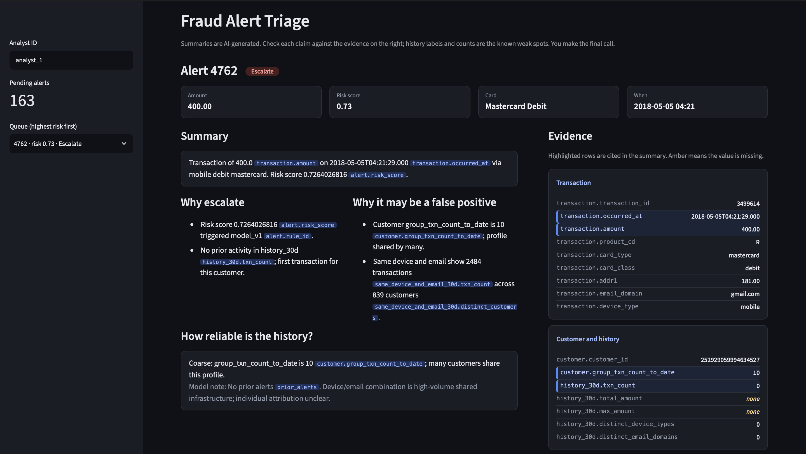
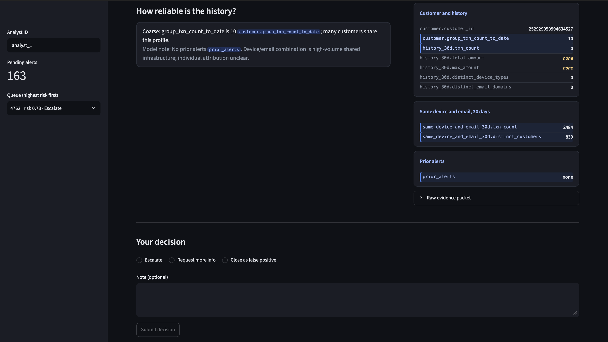

# Fraud Alert Triage Assistant

An analyst-facing tool that turns a fraud alert into a short, evidence-cited summary and a suggested disposition. The analyst sees every claim next to the evidence it cites and makes the final call. Built on the real IEEE-CIS Fraud Detection data with Python, SQL (DuckDB), Claude Haiku 4.5 on Amazon Bedrock, FastAPI and Streamlit.

## The problem

Analysts reviewing alerts spend their time gathering context from several tables before they can decide. The risk on the other side is a fluent summary that states things the data does not say. This project makes a summary checkable, then measures how often it still is not.

## How it works

1. **Evidence packet.** SQL builds a JSON packet per alert: the transaction, customer history, same device and email activity, and prior alerts. The fraud label is never in the packet.
2. **Model.** Claude Haiku 4.5 (temperature 0) returns structured JSON: a summary, reasons to escalate, reasons it may be a false positive, a note on how reliable the history is, and a suggested disposition. Every statement must cite packet fields.
3. **Validator.** Code checks that every citation exists, every number and date appears in the packet, and every field is cited. If it fails, one repair attempt; if that fails too, the analyst gets the raw evidence instead of a summary.
4. **Analyst screen.** Cited rows are highlighted and missing values are amber. No option is pre-selected, and disagreeing with the model requires a written reason. Each decision and its audit record are written together.

## Results (all measured; details in docs/results.md)

| What | Result |
|---|---|
| Validator pass rate, v1 prompt | 8.5% |
| Validator pass rate, v2 strict prompt, first pass | 39.0% |
| v2 after one repair | 81.5% (163 of 200) |
| Same run on AWS EC2 | 164 of 200 passed, 36 fell back to raw evidence |
| Latency on AWS, p50 / p95 | 4.2 s / 11.0 s. The 8 s p95 target was **missed** |
| Human check of 100 validated outputs: claims supported | 87.6% (112 unsupported of 902 claims) |
| Summaries where every claim is supported (the PRD's faithfulness definition) | 25 of 100. The 98% target was **missed** |

The validator passes outputs that a human still finds unsupported, so the validator pass rate is not a faithfulness number.

### Failure patterns, counted by code so they can be reproduced

- The reasons cite 30-day history while the same output says the history is coarse or shared: 37 of 100 reviewed alerts (28 to 47% at 95% confidence).
- Computed durations despite a prompt rule against it: 13 of 100.
- Judgment words in the reasons (a proxy count): 31 of 100.

### What I could not establish

- **Analyst time saved.** No time study was run, so there is no claim here.
- **Whether "misleading" labels are reliable.** Re-scoring 10 cases blind agreed on 5, so I lead with the code-counted patterns above instead.
- **Whether suggested dispositions are right.** There was no ground truth to judge them, and the model leans toward escalate (127 of 163 stored outputs).
- **Single reviewer, with AI help.** I did the scoring, cross-checked against AI-generated scores, with AI-assisted adjudication on the first pass. There was no second human reviewer.

## Security and guardrails

- API key header checked in constant time; parameterized SQL; strict input validation that rejects unknown fields.
- The fraud label and synthetic fields are stripped from every API response (there is a test for this).
- Model text is escaped and shown as plain text.
- One decision per alert (a second attempt returns 409); an override without a reason returns 422.
- Decision and audit record are written in one transaction.
- The API listens on localhost only, interactive docs are off by default, and secrets live in `.env` locally and Secrets Manager on AWS.

## AWS deployment

Deployed for a day to check it runs locked down and to measure latency on real infrastructure: no inbound ports, access through a Session Manager tunnel, an instance role limited to one model, one bucket and one secret. Then torn down and verified empty. See `docs/aws_deployment.md`.

## Design decisions

- **No pre-selected decision**, to avoid anchoring the analyst on the model's suggestion.
- **Raw evidence over unvalidated text** when validation fails.
- **DuckDB, not Postgres**, since one analyst needs one writer. A team deployment would need a managed database.

## Planned next (not done)

Reject outputs that cite history when the history is flagged coarse; add code checks for computed durations, currency symbols and comparison words; treat a missing device type as missing; collapse near-duplicate prior alerts (31 of 100 reviewed alerts had them); then re-run the same 100 alerts for a before and after comparison.

## Run it

You need Python 3.12, the IEEE-CIS data from Kaggle (not included; see `docs/data_notes.md`), AWS credentials with access to the Haiku 4.5 model on Bedrock, and an `API_TOKEN` in `.env`.

    pip install -r requirements.txt
    python3 -m uvicorn src.api:app --port 8000
    python3 -m streamlit run src/ui.py
    python3 -m pytest tests -q

## Repo layout

- `src/` pipeline, API, validator and screen
- `sql/` schema and evidence queries
- `tests/` API, evidence and validator tests
- `docs/` PRD, data notes, results, AWS deployment notes, IAM policy
- `deploy/` the setup files used on the server

## How AI was used

I used Claude as a coding and project coach while building this. I ran and tested the code and made the final calls on scope. I did the scoring, cross-checked against AI-generated scores, with AI-assisted adjudication on the first pass. The product itself also uses Claude Haiku 4.5 on Amazon Bedrock to write the summaries, and that is what the results above measure.
